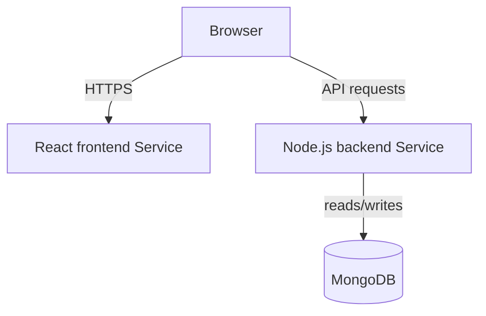

# Cloud Architecture: Helm (The Package Manager for Kubernetes)

### 1. Overview
Helm packages Kubernetes YAML as a chart: templates plus default values. Installing a chart creates a release, which Helm can upgrade and roll back. Teams use it to deploy one app to several environments, and to install third-party software such as databases or monitoring.

### 2. Key Concepts
*   **Chart**: A folder with `Chart.yaml` (metadata), `values.yaml` (defaults), and `templates/`.
*   **Template**: YAML with placeholders such as `{{ .Values.replicaCount }}`. Helm renders it into plain YAML.
*   **Values**: The settings that fill the templates. They come from `values.yaml`, extra `-f` files, and `--set`. Later sources win.
*   **Release**: One installed copy of a chart, for example `my-app-dev` and `my-app-prod` from the same chart.
*   **Revision**: A number Helm adds on every install, upgrade, or rollback of a release.
*   **Repository**: Where charts are published: an HTTP chart repo or an OCI registry (`oci://...`). Artifact Hub is a search site across repos, not a repo.

### 3. Real-World Usage
*   **Environments**: One chart, one values file per environment (replicas, resources, hostnames).
*   **CI/CD**: The pipeline runs `helm upgrade --install` with the new image tag. It installs the first time and upgrades after that.
*   **Third-party software**: Install a monitoring stack from its official chart and override only what you need.
*   **Rollback**: `helm rollback <release> <revision>` re-applies an older revision. It does not undo database migrations run by hooks.

### 4. Tradeoffs
*   **Templates vs. plain YAML**: Templates remove copy-paste, but heavy template logic is hard to read and debug.
*   **Hidden YAML**: You do not see what gets deployed unless you render it. Run `helm template` and review it.
*   **Helm vs. Kustomize**: Helm fills templates and tracks releases. Kustomize patches plain YAML and has no releases. Many teams use both, often through Argo CD or Flux.

### 5. When NOT to Use
*   **Simple apps**: One Deployment and one Service that rarely change are fine as plain YAML with `kubectl apply`.
*   **Overlay preference**: Teams that prefer Kustomize overlays.
*   **Working scripts**: A deployment process that works and is understood needs a clear reason to move.

### 6. Interview Focus
*   **Evolution**: "Why was Tiller removed in Helm 3?"
    *   In Helm 2, the CLI sent requests to Tiller, a server inside the cluster. Tiller usually had cluster-admin rights, so anyone who reached it could act as admin.
    *   Helm 3 has no Tiller. The CLI uses your own kubeconfig, so your own RBAC permissions apply.
    *   Helm 3 releases are namespaced, and upgrades use a three-way merge (old manifest, live state, new manifest), so manual edits in the cluster are not ignored.
    *   Helm 4 (November 2025) uses Kubernetes server-side apply for new releases and has some breaking CLI changes. Test pipelines before switching.
*   **Release state**: "Where does Helm store release data?"
    *   In the cluster: one Secret per revision, in the release's namespace, of type `helm.sh/release.v1`. It holds the chart, values, and rendered manifest.
*   **Preview**: "How do you see what Helm will apply?"
    *   `helm template` renders locally without a cluster.
    *   `--dry-run` on `install` or `upgrade` renders against the cluster without applying.
    *   The `helm-diff` plugin shows what an upgrade would change.

### 7. Common Mistakes
*   **Hardcoded values**: Image tags or hostnames written in templates instead of values.
*   **No `.helmignore`**: Local secrets, `.git`, or `node_modules` end up in the package.
*   **Not bumping `version`**: Changing a chart without a new `version` in `Chart.yaml` makes it unclear which chart a release used, and caches may serve the old one. Rollbacks use revisions, not this version.
*   **Secrets in values files**: Passwords committed in `values.yaml`. Reference an existing Secret, or use External Secrets Operator or SOPS.

### 8. Example: MERN Stack Chart
A React frontend, a Node.js backend, and MongoDB as a dependency chart.



```text
my-mern-stack/
├── Chart.yaml        # metadata and dependencies
├── values.yaml       # default values
├── templates/
│   ├── frontend/     # deployment.yaml, service.yaml
│   ├── backend/      # deployment.yaml, service.yaml, configmap.yaml
│   └── _helpers.tpl  # named templates, e.g. "my-mern-stack.fullname"
└── charts/           # downloaded dependencies
```

`Chart.yaml`: pin the dependency version, and check where the publisher hosts the chart today.

```yaml
apiVersion: v2
name: my-mern-stack
version: 1.0.0
dependencies:
  - name: mongodb
    version: "<pinned-version-range>"
    repository: "<chart-repository-or-oci-url>"
```

`values.yaml` is not a template, so `{{ .Release.Name }}` inside it stays literal text. Build names in the templates.

```yaml
frontend:
  image: myrepo/react-app:v1.0.2
  replicaCount: 3

backend:
  image: myrepo/node-api:v1.0.2
  replicaCount: 2
  mongoSecretName: mongo-credentials   # existing Secret holding the connection string

mongodb:            # values under the subchart's name are passed to the subchart
  auth:
    database: prod_db
```

`templates/backend/deployment.yaml` (container part):

```yaml
      containers:
        - name: api
          image: {{ .Values.backend.image }}
          env:
            - name: MONGO_HOST
              value: {{ printf "%s-mongodb" .Release.Name | quote }}
            - name: MONGO_URI
              valueFrom:
                secretKeyRef:
                  name: {{ .Values.backend.mongoSecretName }}
                  key: uri
```

Workflow:

```bash
helm dependency update ./my-mern-stack
helm template my-release ./my-mern-stack -f values-prod.yaml   # review the output
helm upgrade --install my-release ./my-mern-stack \
  -f values-prod.yaml --namespace production --create-namespace
```
